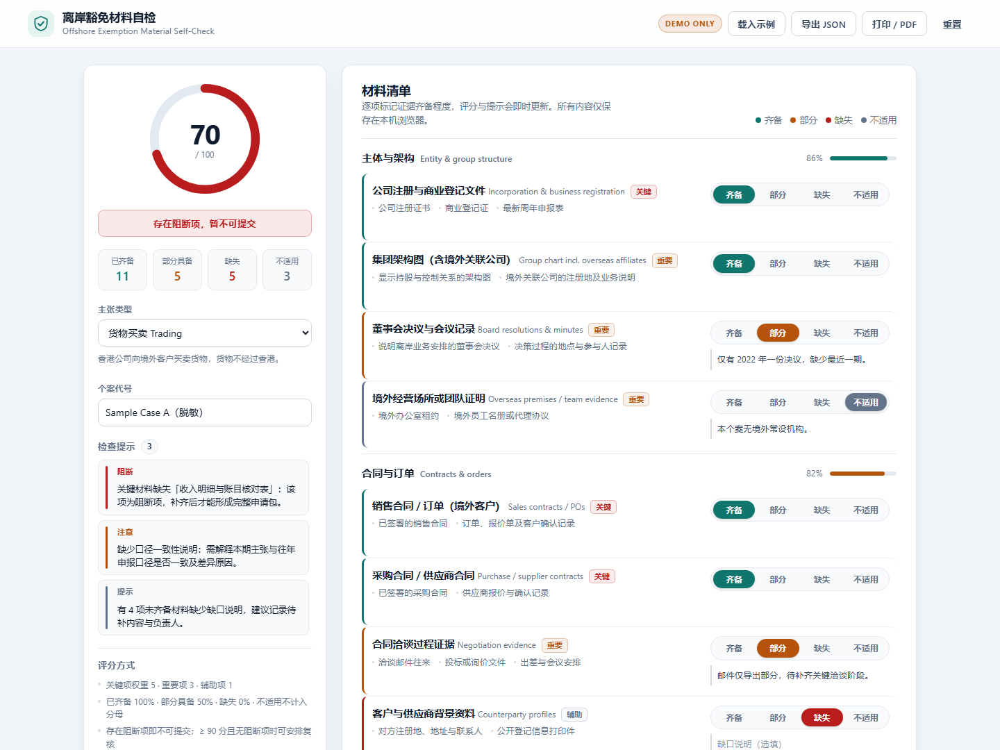
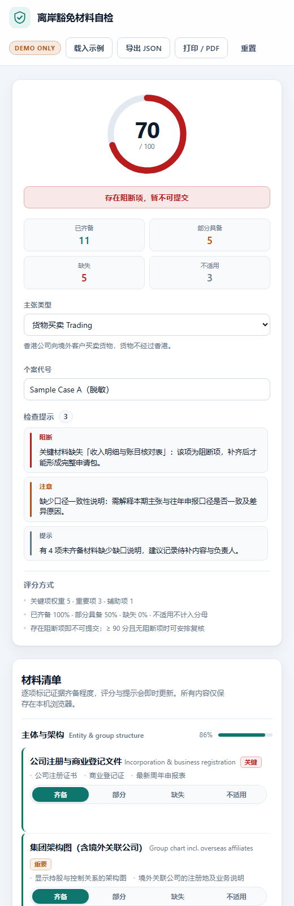
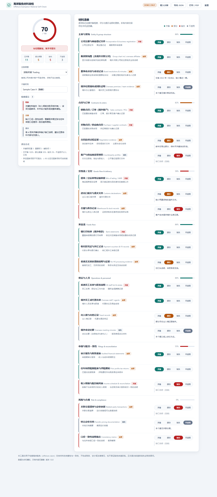

# 离岸豁免材料自检 · Offshore Exemption Material Self-Check

> 一个零依赖的浏览器端自检工具：按类别盘点香港公司离岸豁免（offshore claim）支持材料的齐备程度，给出加权评分、阻断项与缺口清单，并可导出 JSON / PDF 报告。
>
> A zero-dependency, browser-only self-check for the documentary package behind an offshore profits claim: weighted completeness score, blocking gates, gap list, and JSON / print-ready export.

**Demo only.** 仅做材料完整性自检，不构成税务或法律意见，不保证离岸豁免获批。



---

## 项目简介

离岸豁免（offshore claim）能否成立，取决于能否用文件证明利润「不产生于香港」。真正耗时的部分往往不是法律分析，而是**把散落在销售、物流、银行、人事和账目里的证据整理成一份完整且互相印证的申请包**。

本工具把这件事变成一张可勾选的清单：26 个证据项分属 7 个类别，按 4 种典型主张类型（货物买卖 / 服务佣金 / 制造加工 / 知识产权）自动筛选适用项；每项标记「已齐备 / 部分具备 / 缺失 / 不适用」，即可得到一个透明的加权评分、阻断项提示和按类别拆分的缺口清单。全部计算在浏览器本地完成，不联网、不上传、不写入服务器。

适合作为 Upwork 作品集展示：完整的交互逻辑、可测试的纯函数评分内核、真实的合规场景建模，以及一份不依赖任何框架或构建工具的前端实现。

## 问题与场景

**场景。** 一家香港贸易公司准备就某一课税年度申请离岸利润豁免。会计同事手上有一个文件柜的合同、提单、月结单和邮件，但没人能快速回答三个问题：

1. 材料够不够？还差哪几份？
2. 哪些缺口是「补一下就行」，哪些会让整份申请包直接站不住？
3. 不同年度、不同个案之间，口径是否一致？

传统做法是顾问凭经验逐页翻，结论分散在邮件里，交接给下一位同事时又要重来一遍。本工具把这些问题固定成一次可重复、可导出、可对比的自检。

**设计取舍。**

- **清单而非结论。** 工具只判断「材料是否齐备、是否互相矛盾」，不判断「离岸主张是否成立」——后者需要执业税务顾问的专业判断。
- **阻断项优先于分数。** 缺失一份关键材料（如提单或收入核对表）时，即使总分 70，结论仍是「暂不可提交」，避免用高分掩盖致命缺口。
- **不适用要留痕。** 每一项都可以标记「不适用」，但必须写下理由；关键项被标记为不适用时直接报错，因为把关键证据「解释掉」正是审核中最容易被挑战的做法。

## 功能

- **4 种主张类型**：货物买卖、服务/佣金、制造与加工、知识产权/特许权；切换类型即时重算适用项与评分。
- **26 个证据项 / 7 个类别**：主体与架构、合同与订单、货物流/交付、资金流、营运与人员、申报与账目一致性、风险与合规。当前主张类型下适用 21–24 项。
- **三级重要性**：关键（权重 5，共 9 项）、重要（权重 3）、辅助（权重 1）。
- **加权评分**：已齐备 100%、部分具备 50%、缺失 0%；「不适用」不计入分母，不会因为合理的豁免而虚高或失真。
- **三档结论**：`暂不可提交`（存在阻断项）/ `需要补充或复核`（有警告或分数 < 90）/ `材料齐备，可安排复核`（无任何提示且 ≥ 90）。
- **10 条一致性规则**：例如买卖型个案缺少提单、银行流水与收入无法对应、关联交易没有定价依据、关键项被标记为不适用等，逐条给出可读的中文说明。
- **缺口备注**：每一项可填写待补内容与责任说明；未齐备却未写备注的项目会被单独提示。
- **导出 JSON**：包含分数、分类别得分、规则命中与逐项状态，便于归档或做年度对比。
- **打印 / PDF**：内置打印样式，自动隐藏交互控件并展开状态文字，可直接交付给复核人。
- **本地持久化**：状态写入 `localStorage`，刷新不丢失；一键重置或载入脱敏示例个案。
- **可访问性**：状态按钮带 `aria-pressed`，分组带 `role="group"` 与可读标签，提供跳转链接与可见焦点样式。

## 架构

```
assets/js/data/checklist.js   ──┐
  静态数据：主张类型、类别、                               ┌─► 摘要面板（评分环 / 计数 / 提示）
  证据项、脱敏示例个案                                    │
                                ├─► assets/js/core/scoring.js ──┤
assets/js/ui/app.js  ──────────┘   evaluate() 纯函数          └─► 清单渲染（类别 / 状态 / 备注）
  状态管理 + 渲染 + 事件             buildFindings() 规则               │
  localStorage 持久化               buildExport() 导出载荷               └─► JSON / 打印
```

**分层。**

| 层 | 文件 | 职责 | 依赖 DOM |
| --- | --- | --- | --- |
| 数据 | `assets/js/data/checklist.js` | 主张类型、类别、26 个证据项、脱敏示例个案 | 否 |
| 内核 | `assets/js/core/scoring.js` | 权重、评分、阻断门禁、规则引擎、导出载荷 | **否**（纯函数） |
| 界面 | `assets/js/ui/app.js` | 状态、渲染、事件委托、持久化、导出与打印 | 是 |

**内核契约。** `evaluate(data, state)` 只接收数据与状态，返回 `{ score, gate, counts, categories, rows, findings }`，不触碰 DOM、不读时钟、不写存储——因此可以在 Node 里直接做单元测试（`tests/scoring.test.js`，19 个用例）。`buildExport(data, state)` 是唯一会读取当前时间的函数。

**状态模型。**

```json
{
  "version": 1,
  "scenario": "trading",
  "caseName": "Sample Case A（脱敏）",
  "statuses": {
    "contract-sales": { "status": "present", "note": "" },
    "goods-customs": { "status": "partial", "note": "缺少两票货物的清关文件。" }
  }
}
```

**评分算法。**

```
score = round( Σ(weight × value) / Σ(weight) × 100 )
weight ∈ { critical: 5, important: 3, supporting: 1 }
value  ∈ { present: 1, partial: 0.5, missing: 0 }   // status = na 时不计入分子分母
```

**门禁。**

| 结论 | 条件 |
| --- | --- |
| `blocked` 暂不可提交 | 任一 `error` 级规则命中（如关键项缺失、关键项被标记不适用） |
| `attention` 需要补充或复核 | 无 error，但存在 `warning`，或分数 < 90 |
| `ready` 材料齐备，可安排复核 | 无任何规则命中且分数 ≥ 90 |

## 快速开始

无需安装依赖、无需构建，双击打开即可：

```bash
# 方式一：直接打开
# 在文件管理器中双击 index.html

# 方式二：本地静态服务器（推荐，行为与线上一致）
python -m http.server 8080
# 浏览器访问 http://localhost:8080
```

首次打开会自动载入脱敏示例个案（70 分、存在阻断项），可直接体验评分、备注与导出。

运行评分内核的单元测试（仅需 Node，无第三方依赖）：

```bash
node tests/scoring.test.js
# 或
npm test
```

按提示操作：

1. 选择主张类型（默认「货物买卖」）。
2. 填写个案代号（仅本地保存）。
3. 逐项选择状态：齐备 / 部分 / 缺失 / 不适用；未齐备的项目填写缺口说明。
4. 查看左侧评分、结论与检查提示。
5. 「导出 JSON」留档，或「打印 / PDF」交付复核。

> `DEMO.md` 提供了一份 5 分钟的逐步演示脚本与截图说明。

## 演示截图/GIF

| 主界面（1440×1080） | 窄屏（520×1600） |
| --- | --- |
|  |  |

完整长图（全部 7 个类别）：



截图由 Chrome 无头模式对 `index.html` 直接渲染生成，未做任何后期修补。如需替换或补充 GIF，见 [`docs/screenshots/README.md`](docs/screenshots/README.md)。

## 技术栈

| 项目 | 选择 | 原因 |
| --- | --- | --- |
| 结构与样式 | 原生 HTML5 + CSS（自定义属性、Grid、`clamp()`、`color-mix()`、`prefers-color-scheme`） | 无构建、可离线、单文件即可审阅 |
| 逻辑 | 原生 JavaScript（ES5 语法，IIFE + UMD 风格导出） | 兼容 `file://` 直接打开，且同一份文件可在 Node 中被 `require` |
| 测试 | Node 内置 `assert` + 自建极简运行器 | 零依赖，`node tests/scoring.test.js` 即可 |
| 持久化 | `localStorage` | 无后端、无账号、无数据出口 |
| 导出 | `Blob` + `URL.createObjectURL`、`window.print()` | 浏览器原生能力，不引入 PDF 库 |
| 字体 | 系统字体栈 | 无外链字体，离线可用 |

## 目录结构

```
.
├── index.html                      # 单页应用入口
├── assets
│   ├── css
│   │   └── styles.css              # 主题、布局、打印样式
│   └── js
│       ├── core
│       │   └── scoring.js          # 纯函数评分内核与规则引擎
│       ├── data
│       │   └── checklist.js        # 主张类型、类别、证据项、脱敏示例
│       └── ui
│           └── app.js              # 状态、渲染、事件、导出
├── tests
│   └── scoring.test.js             # 19 个单元测试（node）
├── docs
│   ├── SOURCES.md                  # 来源仓库登记与脱敏边界
│   └── screenshots                 # 截图与拍摄说明
├── README.md
├── DEMO.md                         # 演示脚本
├── SECURITY.md                     # 安全策略与数据处理
├── LICENSE                         # MIT
├── package.json                    # 仅提供 npm test，无任何依赖
├── .gitattributes                  # 换行符与二进制规则
└── .gitignore
```

## 来源仓库 · Source repositories

本仓库是一个独立演示，**不包含**下列仓库的代码或数据。它们同属香港公司 / 离岸合规方向的项目集，作为本工具的上下文与来源登记在案（完整清单见 [`docs/SOURCES.md`](docs/SOURCES.md)）。

| 仓库（均为 private） | 角色 | 技术栈 | 与本品的关系 |
| --- | --- | --- | --- |
| `wanqushangpai-odoo` | 香港公司 Odoo 18 记账中台：SME-FRS 科目表、多币种流水采集、离岸豁免辅助核算 | Odoo 18 · Python · PostgreSQL · Docker | 账务与审计底稿来源；本工具的自检项与之对应 |
| `wanqushangpai-odoo-infra` | 上述中台的一键部署与运维 | Docker Compose · Nginx · Certbot | 部署层，与本工具无运行时依赖 |
| `group-sop` | 竞标 / 经纪 / PDF 解析引擎 | React 19 · TypeScript · Cloudflare Workers · D1 · R2 | 同一业务方向的工程样例 |
| `crypto-reconciliation-cleaner` | 离线加密交易对账清洗器（单文件） | 单文件 HTML/JS | 同一设计取向：零依赖、数据不出本机 |
| `outshore` | 离岸证据链技术劳务落地页 | 单文件 HTML/JS | Upwork 服务端页面 |

> 以上仓库目前为私有，公开链接无法直接访问；如需演示或源码 walkthrough，请通过 [GitHub 主页](https://github.com/zhetai) 联系。本仓库不复制它们的代码，也不含其客户或业务数据。

## 脱敏说明

本仓库是**从零构建的演示项目**，不包含任何真实客户、真实个案或真实税务申报数据：

- 所有证据项均为通用描述（「已签署的销售合同」「覆盖申报期的银行月结单」），不含具体主体名称。
- 示例个案 `Sample Case A（脱敏）` 的状态与备注为虚构的演示内容，用于展示部分齐备、缺失与不适用的混合情形。
- 不含 `.env`、密钥、令牌、私钥、内部域名、邮箱或客户名称；若后续要接入真实数据，请自行脱敏并遵循 `SECURITY.md`。
- 未复制任何来源仓库（`wanqushangpai-odoo` 等 5 个私有仓库）的代码或业务数据，边界见 [`docs/SOURCES.md`](docs/SOURCES.md)。
- 提交前已对仓库执行高置信 secret 扫描（GitHub 令牌、私钥、云厂商密钥、`.env`、`node_modules`、`dist` 等），结果为零命中。

如果在本仓库中发现疑似敏感信息，请按 `SECURITY.md` 的方式私下报告，不要公开提交 issue。

## 限制与免责声明

- **不构成税务或法律意见。** 本工具只做材料完整性与一致性的自检，不判断离岸主张是否成立，也不保证豁免获批。
- **不是税务计算器。** 不做任何税额计算、不处理两级制税率、不生成报税表。
- **清单非权威。** 26 个证据项是基于公开实务经验整理的演示清单，不能替代税务局指引、案例法或顾问意见；不同行业、不同交易结构所需材料可能完全不同。
- **评分是管理工具。** 权重与 90 分门槛是演示用的启发式设定，不代表任何官方标准。
- **不含签署与存证。** 不做电子签名、时间戳或哈希存证；导出的 JSON 仅作内部归档参考。
- **数据仅在本机。** 全部状态存于浏览器 `localStorage`，清理浏览器数据即丢失，且不提供跨设备同步。
- **演示范围。** 未实现多用户、权限、后端存储、审计日志；如用于生产环境需另行设计。

## License

[MIT](LICENSE) © 2025 zhetai

---

演示用途，非税务或法律意见。
